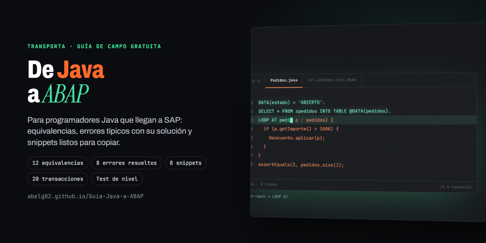
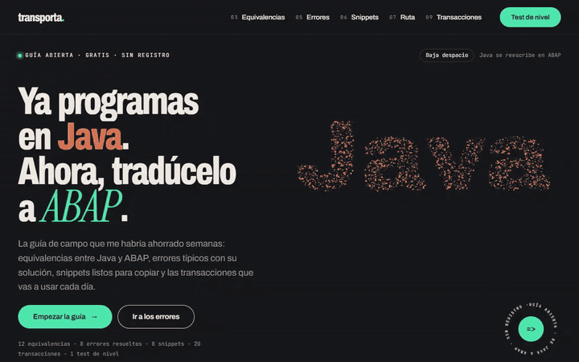
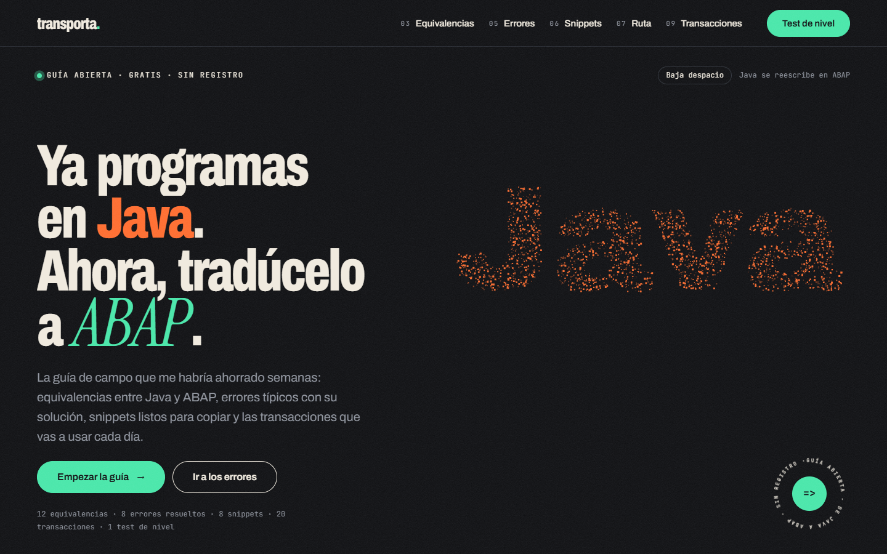
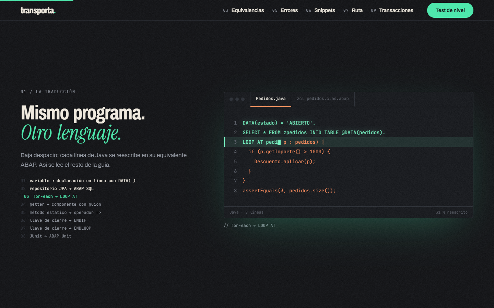
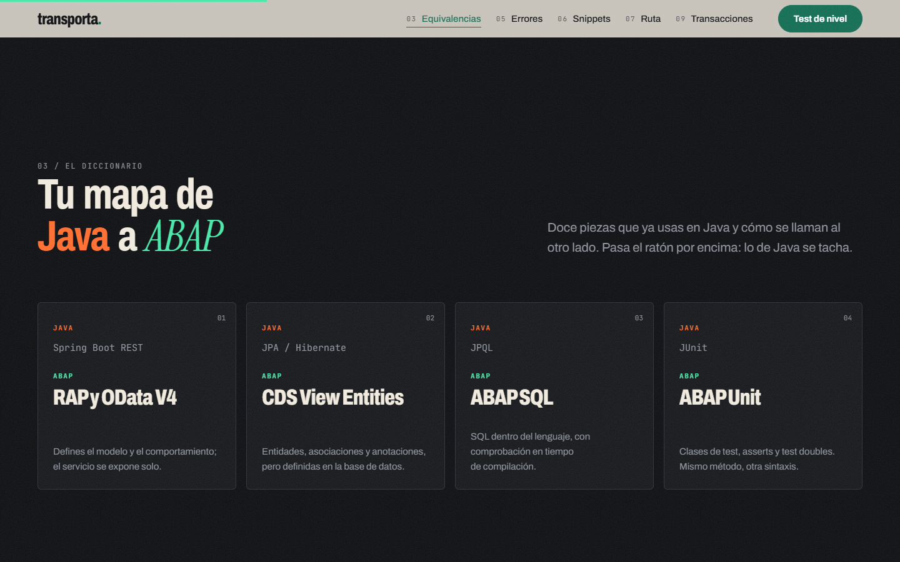
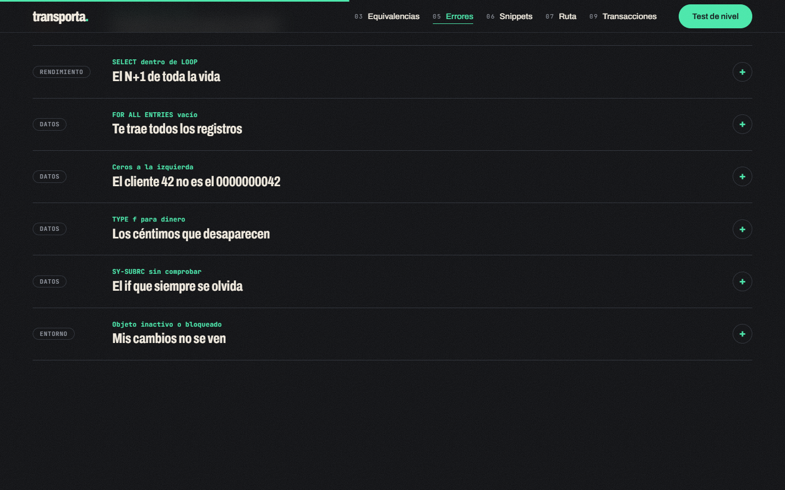

<p align="center">
  
</p>

<h1 align="center">Transporta · De Java a ABAP</h1>

<p align="center">
  La guía de campo que me habría ahorrado semanas al pasar de Java a SAP ABAP.<br>
  Equivalencias entre los dos lenguajes, errores típicos con su solución, snippets listos para copiar y las transacciones que vas a usar cada día.
</p>

<p align="center">
  <a href="https://abelg02.github.io/Guia-Java-a-ABAP/"><b>Leer la guía</b></a> ·
  <a href="https://abelg02.github.io/Proyecto-SAP-ABAP/">Herramientas ABAP</a> ·
  <a href="https://abelg02.github.io/portfolio">Portfolio</a>
</p>

<p align="center">
  
</p>

## Qué hay dentro

| Sección | Contenido |
|---|---|
| **La traducción** | Un mismo programa escrito en Java y reescrito línea a línea en ABAP moderno. |
| **Equivalencias** | 12 piezas que ya usas en Java y cómo se llaman en ABAP: Spring Boot REST → RAP y OData V4, JPA → CDS, JPQL → ABAP SQL, JUnit → ABAP Unit… |
| **Errores típicos** | 8 errores que todos cometemos al empezar (SELECT dentro de un LOOP, FOR ALL ENTRIES vacío, ceros a la izquierda…) con su causa y su solución. |
| **Snippets** | 8 fragmentos de ABAP moderno listos para copiar. |
| **Ruta de aprendizaje** | De cero a ABAP moderno en 5 etapas, con un plan realista para la primera semana. |
| **Transporte** | Cómo viaja el código en SAP (desarrollo, calidad, producción) comparado con git y un pipeline. |
| **Transacciones** | Las 20 transacciones del día a día. |
| **Test de nivel** | Preguntas finales para saber por dónde seguir. |

Gratis, sin registro y sin publicidad.

## Capturas

| Inicio | Mismo programa, otro lenguaje |
|---|---|
|  |  |
| **Tu mapa de Java a ABAP** | **Errores típicos** |
|  |  |

## Cómo está hecha

- HTML, CSS y JavaScript, **sin frameworks ni dependencias**.
- La portada dibuja la palabra Java con partículas en `canvas`, que se reordenan con el ratón.
- Respeta la preferencia de "reducir movimiento" del sistema y funciona en el móvil.
- Se publica en GitHub Pages con GitHub Actions en cada cambio.

```
index.html      la guía completa
404.html        página de error
css/            estilos por capas (base, layout, componentes, efectos)
js/             núcleo, partículas, escenas, guía y test de nivel
assets/         iconos, imagen del autor y vista previa para redes
docs/           portada, demostración y capturas del README
```

Para verla en local basta con abrir `index.html` o servir la carpeta con cualquier servidor estático:

```bash
npx http-server .
```

## Autor

**Abel González Guerra** · Desarrollador SAP ABAP Cloud y full-stack · [github.com/abelg02](https://github.com/abelg02)

Proyecto independiente, no afiliado a SAP ni a Oracle.
